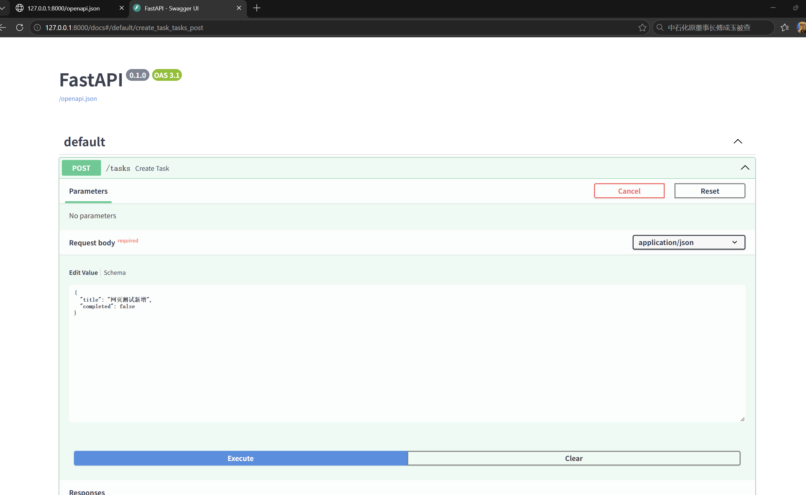
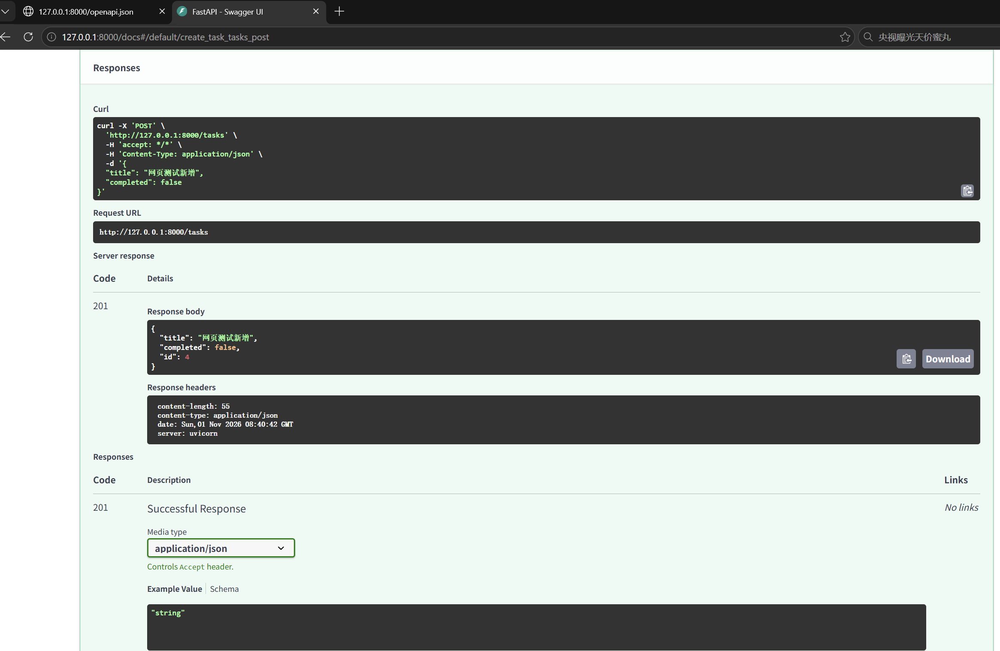
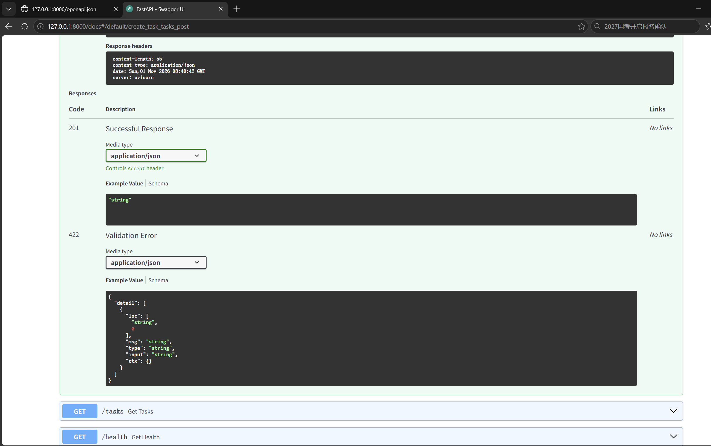

# 第四周 Day 2 作业：请求体与新增任务 (POST)

## 一、 代码实现

```python
from fastapi import FastAPI, HTTPException, status
from pydantic import BaseModel, Field

app = FastAPI()

tasks_db = [
    {"id": 1, "title": "玩儿原神", "completed": True},
    {"id": 2, "title": "玩儿崩铁", "completed": True},
    {"id": 3, "title": "玩儿鸣潮", "completed": False}
]

# ==================== 第二天：请求体与新增任务 ====================

class TaskCreate(BaseModel):
    title: str = Field(..., min_length=1, description="任务标题，必填")
    completed: bool = False

current_id = 3 

@app.post("/tasks", status_code=status.HTTP_201_CREATED)
def create_task(task_in: TaskCreate):
    global current_id
    current_id += 1 
    
    new_task = task_in.model_dump()
    new_task["id"] = current_id
    
    tasks_db.append(new_task)
    
    return new_task

# ==================== 原有接口 ====================

@app.get("/health")
def get_health():
    return {"status": "ok", "message": "正常运行！"}

@app.get("/tasks")
def get_tasks(completed: bool = None):
    if completed is None:
        return tasks_db
    result = []
    for task in tasks_db:
        if task["completed"] == completed:
            result.append(task)
    if len(result) == 0:
        return []
    return result

@app.get("/tasks/{task_id}")
def get_task(task_id: int):
    for task in tasks_db:
        if task["id"] == task_id:
            return task

    raise HTTPException(status_code=404, detail="Task not found")
```

##二、接口测试截图

### 正常新增 (POST) 返回 201




### 校验失败返回 422

