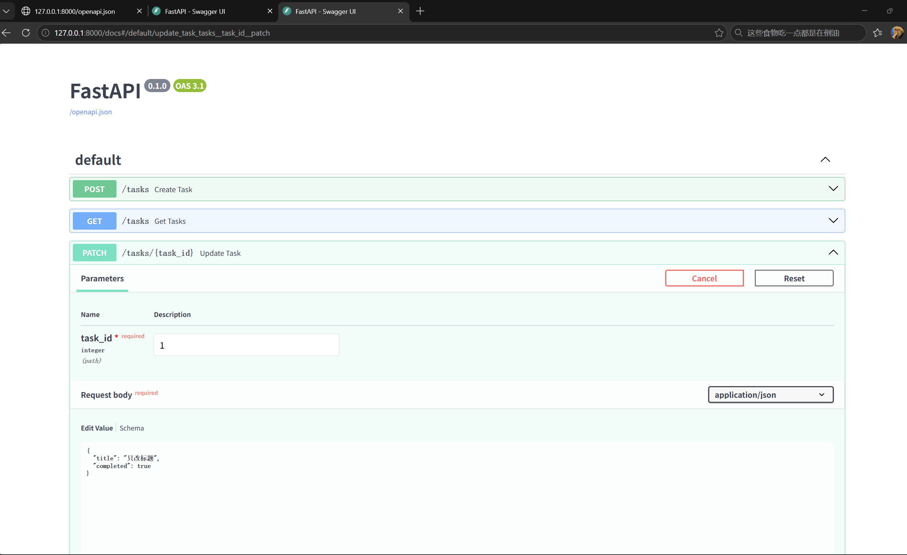
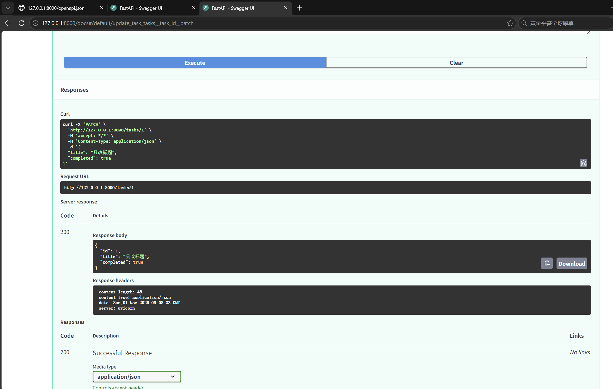
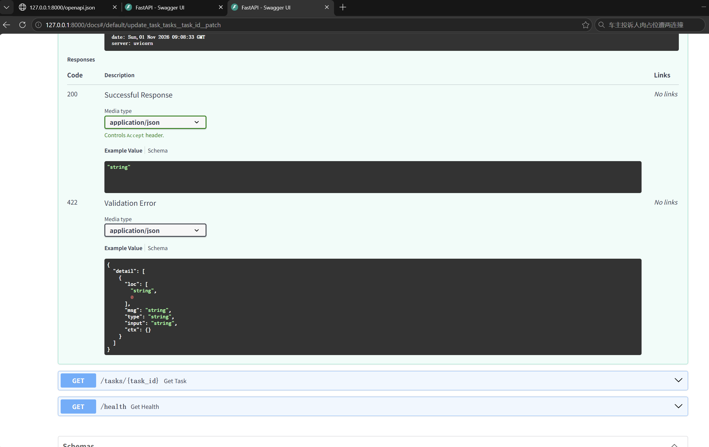
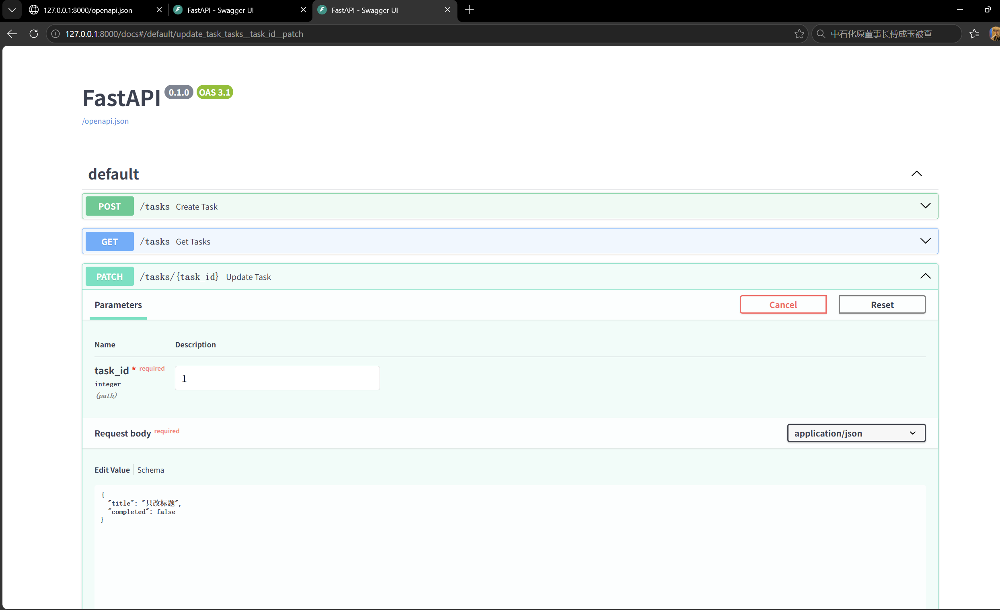
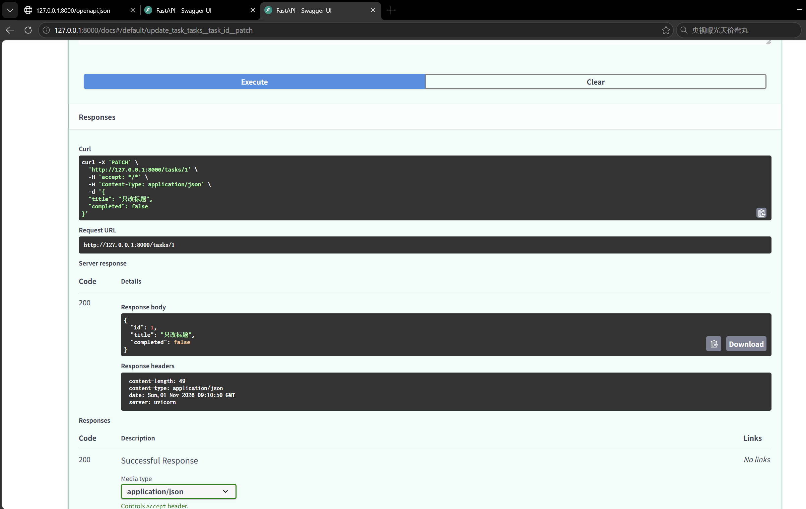
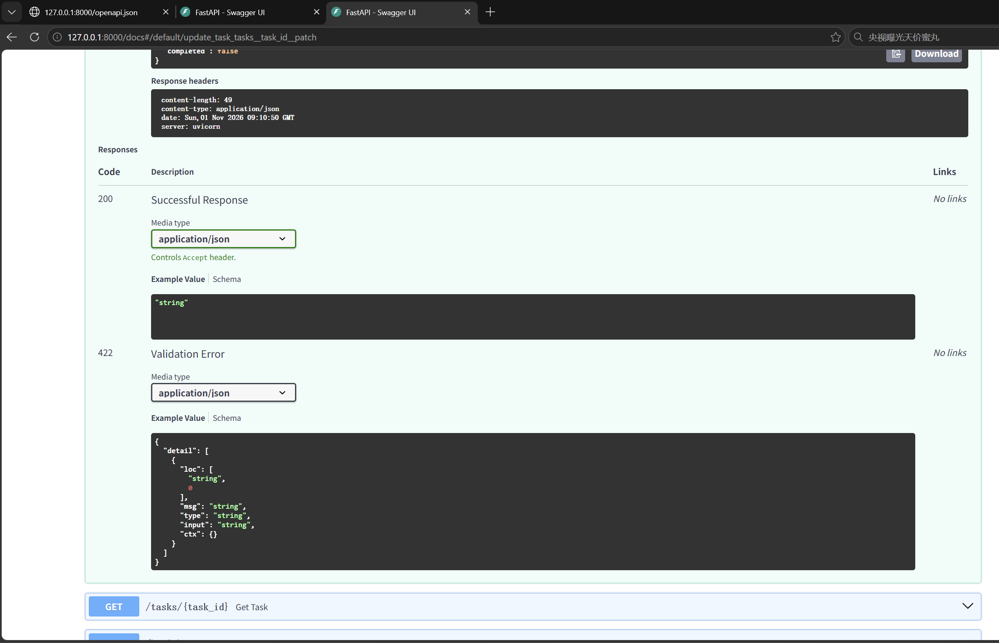
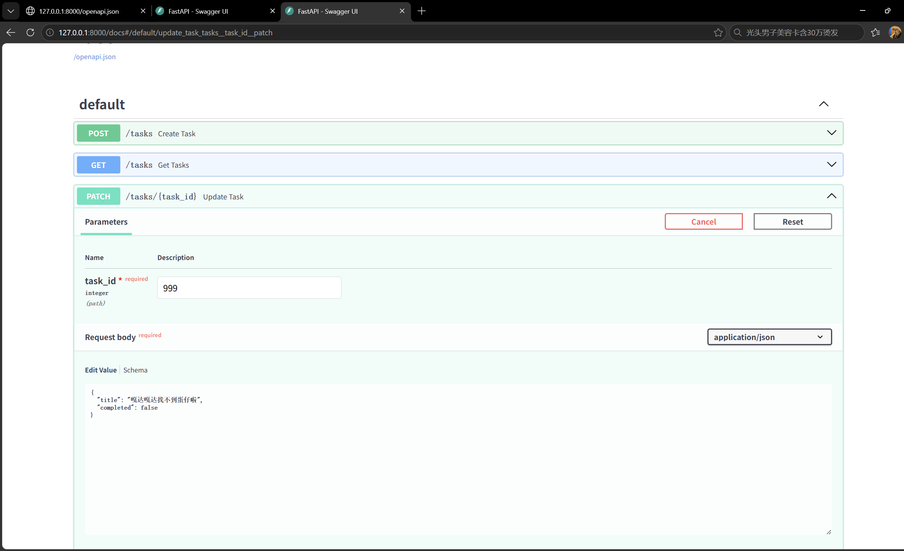
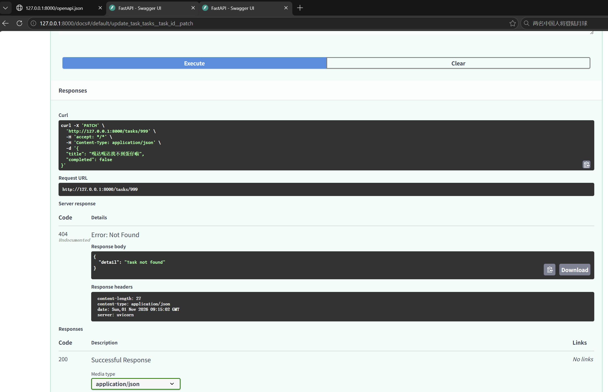
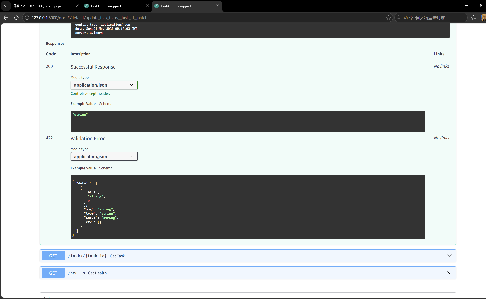

# 第三天作业

## 一、核心代码实现

```python
from fastapi import FastAPI, HTTPException, status
from pydantic import BaseModel, Field
from typing import Optional

app = FastAPI()

tasks_db = [
    {"id": 1, "title": "玩儿原神", "completed": True},
    {"id": 2, "title": "玩儿崩铁", "completed": True},
    {"id": 3, "title": "玩儿鸣潮", "completed": False}
]

current_id = 3

# ==================== 新增 (POST) ====================
class TaskCreate(BaseModel):
    title: str = Field(..., min_length=1)
    completed: bool = False

@app.post("/tasks", status_code=status.HTTP_201_CREATED)
def create_task(task_in: TaskCreate):
    global current_id
    current_id += 1
    new_task = task_in.model_dump()
    new_task["id"] = current_id
    tasks_db.append(new_task)
    return new_task

# ==================== 修改 (PATCH) ====================
class TaskUpdate(BaseModel):
    title: Optional[str] = Field(None, min_length=1)
    completed: Optional[bool] = None

@app.patch("/tasks/{task_id}")
def update_task(task_id: int, task_in: TaskUpdate):
    for task in tasks_db:
        if task["id"] == task_id:
            # 核心：只提取实际传入的字段，排除未传字段
            update_data = task_in.model_dump(exclude_unset=True)
            for key, value in update_data.items():
                task[key] = value
            return task
    raise HTTPException(status_code=404, detail="Task not found")

# ==================== 查询 (GET) ====================
@app.get("/health")
def get_health():
    return {"status": "ok", "message": "正常运行！"}

@app.get("/tasks")
def get_tasks(completed: bool = None):
    if completed is None:
        return tasks_db
    result = []
    for task in tasks_db:
        if task["completed"] == completed:
            result.append(task)
    return result

@app.get("/tasks/{task_id}")
def get_task(task_id: int):
    for task in tasks_db:
        if task["id"] == task_id:
            return task
    raise HTTPException(status_code=404, detail="Task not found")
```

## 二、测试截图

### 1、分别修改标题




### 2、标记完成及改回未完成




### 3、空格题和无效编号有明确错误响应


